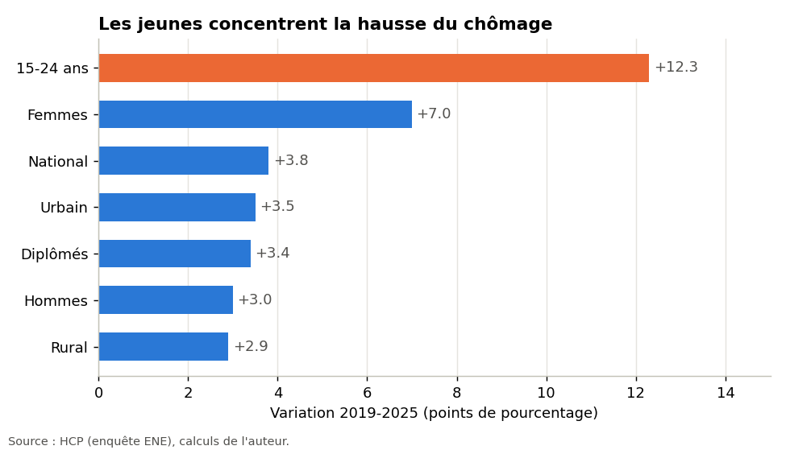

# Chômage au Maroc : quelle tranche d'âge porte la hausse ? (2018-2025)

Projet de data science basé sur les taux de chômage annuels du Haut-Commissariat au Plan (HCP).

## Question

Depuis 2019, le chômage a fortement augmenté au Maroc. Cette hausse touche-t-elle tout le monde de la même façon, ou se concentre-t-elle sur certains groupes (jeunes, femmes, diplômés, citadins) ?

## Principaux résultats

| | 2019 | 2025 | Variation |
|---|---|---|---|
| National | 9,2 % | 13,0 % | +3,8 pts |
| 15-24 ans | 24,9 % | 37,2 % | **+12,3 pts** |
| Femmes | 13,5 % | 20,5 % | +7,0 pts |
| Hommes | 7,8 % | 10,8 % | +3,0 pts |
| Diplômés | 15,7 % | 19,1 % | +3,4 pts |

- Les 15-24 ans connaissent la plus forte hausse en points et sont 2,6 à 2,9 fois plus touchés que la moyenne.
- Le chômage décroît avec l'âge : 37,2 % (15-24 ans), 20,9 % (25-34), 7,2 % (35-44), 3,6 % (45 ans et plus) en 2025.
- L'écart femmes-hommes passe de 5,7 à 9,7 points.

Détail, graphiques et limites dans le notebook [`analyse_chomage_age.ipynb`](analyse_chomage_age.ipynb).



## Contenu

```
├── analyse_chomage_age.ipynb          # notebook (Colab ou Jupyter), déjà exécuté
├── data/
│   ├── chomage_age_2018_2025.csv      # taux annuels par groupe
│   └── SOURCES.md                     # origine de chaque valeur
├── figures/                           # graphiques exportés
├── requirements.txt
└── LICENSE
```

## Exécuter le projet

**Google Colab** : ouvrez le notebook, lancez la première cellule de code et importez `data/chomage_age_2018_2025.csv` quand il vous le demande.

**En local** :

```bash
pip install -r requirements.txt
jupyter notebook analyse_chomage_age.ipynb
```

## Données et limites

- Source : HCP (enquête nationale sur l'emploi, ENE), relevée dans les notes annuelles et la presse économique. Valeurs saisies à la main : à recouper avec [hcp.ma](https://www.hcp.ma).
- Détail par tranche d'âge disponible à partir de 2022 seulement.
- Depuis 2026, le HCP utilise la nouvelle enquête EMO2026, non comparable : la série s'arrête donc à 2025.
- Analyse descriptive : elle ne démontre pas de lien de cause à effet.

## Auteur

Anass Chahid, Master Commerce International, ENCG Settat.

## Licence

MIT (voir `LICENSE`). Les données restent la propriété du HCP.
